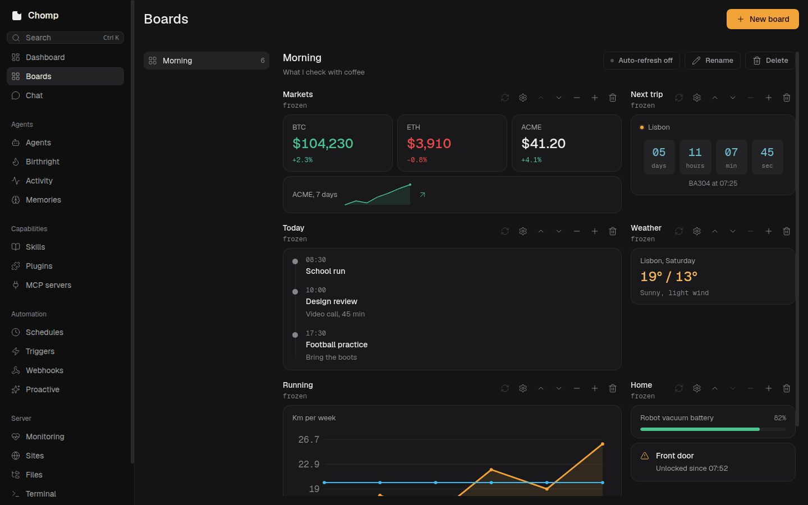
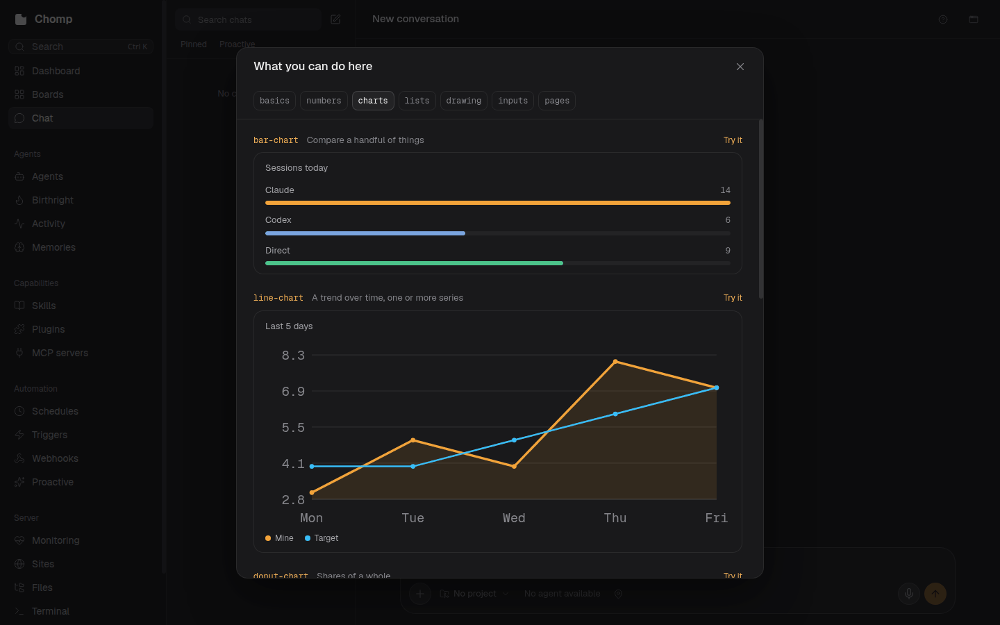
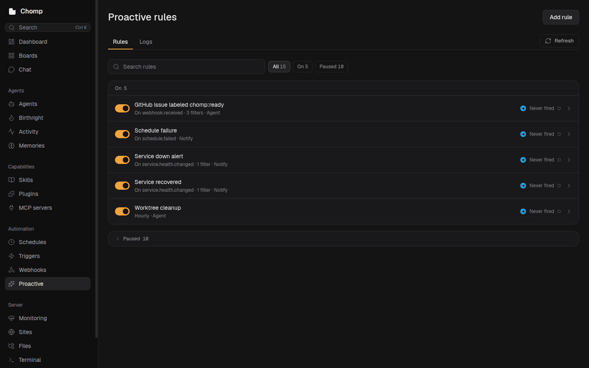
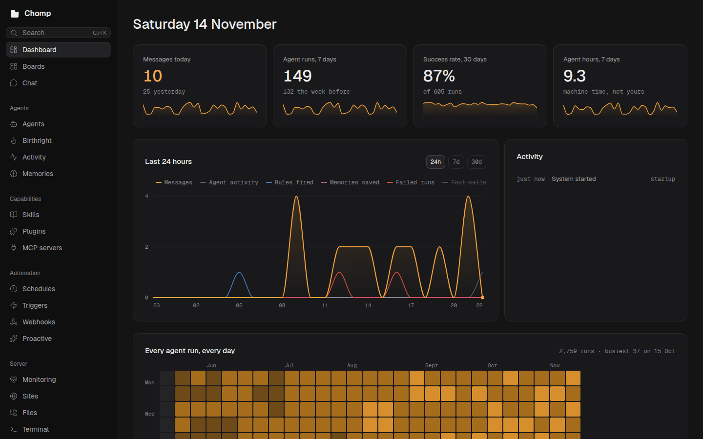
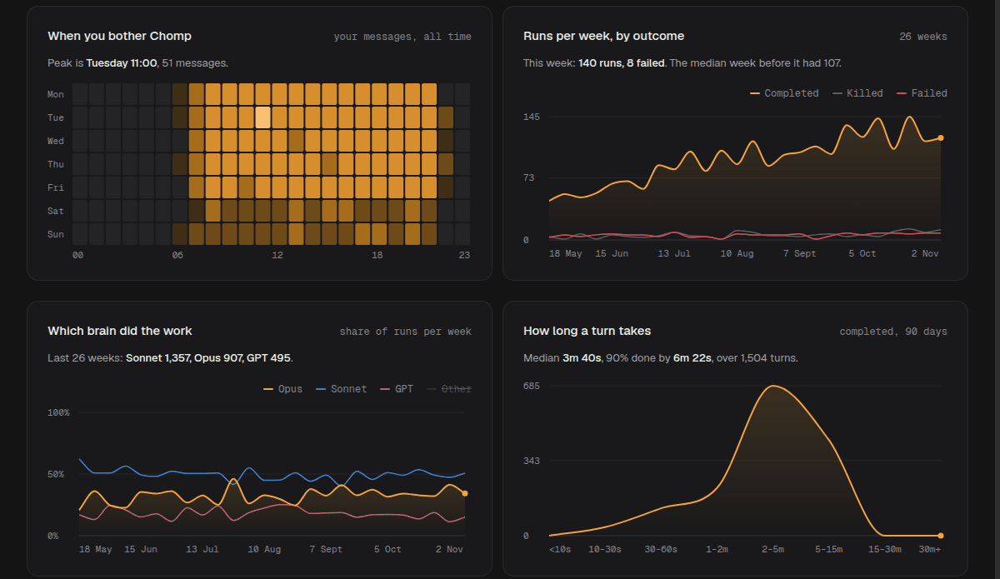

<p align="center">
  
</p>

<h1 align="center">Chomp</h1>

<p align="center">
  <b>A personal AI assistant that lives on your own machine.</b><br>
  Claude Code or Codex agents with memory, rules, boards, a live browser and an iPhone app.
</p>

<p align="center">
  <a href="https://github.com/ggi3201/chompbot/actions/workflows/ci.yml"></a>
  <a href="LICENSE"></a>
  
  
  
</p>

A personal AI assistant that runs on your own machine. You chat with it in a web app,
on Telegram or Discord, or by voice, and every message runs as an agent turn in the
Claude Code or Codex CLI with Chomp's tools: memory, Gmail, Calendar, Drive, rules
that run on a schedule or on events, dashboards, a live browser preview, published
sites and more.

It is built for **one person, on a private network**. The agents can run shell
commands on the host, and one password protects everything, so reach it over
Tailscale and do not put it on the public internet. [`SETUP.md`](SETUP.md) explains
why and how.



## What it does

- **Chat anywhere.** The web app, Telegram, Discord, or hands-free voice. Every
  message is a real agent turn on the Claude Code or Codex login you already have,
  so there are no API tokens to pay for chat.
- **Answers you can see.** Replies can hold cards, charts, tables, timelines, forms
  and drawings instead of a wall of text, and any of them can be pinned to a board.
- **Boards.** Dashboards of widgets that an agent builds for you and keeps fresh on a
  schedule (the picture above).
- **Memory.** It remembers facts and preferences from your chats, searches them by
  meaning (Ollama, OpenAI or Gemini embeddings), and an optional weekly "dream" proposes
  clean-ups for you to approve.
- **Proactive rules.** Prompts that run on a schedule, on an event (a webhook, a
  failed job, a service going down) or when a script says so, and only message you
  when something needs you.
- **Agents with a personality.** Birthright is a short interview that gives your
  assistant its character. Make more agents ("souls") for different jobs and pick
  one per chat with `@`.
- **Skills, plugins and MCP servers.** It reads Claude Code skills and plugins, so
  you teach it a new trick by writing a `SKILL.md`. Seeded skills cover weather,
  news, stocks, crypto, football, GitHub, Gmail and Calendar.
- **Your server, in a browser tab.** Monitoring of the machine and its containers
  and ports, a file browser, a terminal, a live preview of whatever an agent is
  building, and static sites it can publish for you.
- **A native iPhone app.** Chat and talk to it, see what's next on a home-screen
  widget, and answer it from the lock screen (details below).
- **Insights.** A dashboard of what your agents actually did: runs per day, success
  rate, which model did the work, how long turns take, which rules fire.
- **Try before you trust.** Dry-run a rule against real data before you switch it
  on, and switch any skill or rule off with one tap.

<table>
  <tr>
    <td></td>
    <td></td>
  </tr>
  <tr>
    <td></td>
    <td></td>
  </tr>
</table>

## Insights

Every agent run, message, rule check and tool call is counted, so you can see what
your assistant is doing and what it costs you in machine time.





## The iPhone app

A native SwiftUI app and widget in [`packages/ios`](packages/ios). It talks straight to
your own Chomp over Tailscale.

- **Chat and voice.** The same conversations as the web app, with charts and cards
  drawn natively, plus a hands-free voice mode.
- **Widget.** Time-windowed cards on your home and lock screen: when to leave, what
  is next today, gate and seat.
- **Ask Chomp from anywhere.** A Siri and Shortcuts action that takes a question and
  an optional photo.
- **Answers from the lock screen.** Approve or decline what a supervised agent wants
  to do, or reply to its question, with Face ID.
- **Your phone as a tool.** With your permission, agents can read your calendar,
  contacts, photos, Health data and location, post notifications and run Shortcuts.

Build it with Xcode and XcodeGen, using your own bundle ID and team
([`SETUP.md`](SETUP.md) has the steps).

## Tested

Around 1,300 tests: 1,100 for the API, 140 for the web app, 74 XCTests for the iOS
app, and suites for the CLI and the outside probe. Every push and pull request runs
the build, a type check and the tests on Node 22 and 24
([`ci.yml`](.github/workflows/ci.yml)).

The screenshots are from a fresh install with sample data.

## Setup

**[`SETUP.md`](SETUP.md)** covers it from start to finish: required and recommended
tools, install, first login, running it as a service, Tailscale, and the add-ons.
It is written so that you can hand it to Claude Code or Codex and let it do the
setup with you.

The short version, for local development:

```bash
corepack enable
pnpm install --frozen-lockfile
cp .env.example .env          # then set JWT_SECRET to a long random value
pnpm dev                      # API on :3001, web on :5173
```

Open `http://localhost:5173`, choose a password, then open **Birthright** in the side menu: a
short interview that gives your assistant its personality.
You need Node 22 or newer and the Claude Code CLI, logged in.

## Stack

- **API:** Node, Express 5, WebSocket, Drizzle ORM on SQLite (`better-sqlite3`), JWT auth
- **Web:** React 19, Vite, Tailwind v4, Framer Motion
- **Agents:** Claude Agent SDK and Codex, which reach Chomp through its MCP server (`chomp-api`)
- **iOS:** a SwiftUI app and widget in `packages/ios` (optional)
- **Tooling:** pnpm 10 workspaces, TypeScript strict, Vitest, ESM throughout

## Repo layout

```
packages/
  api/            HTTP + WebSocket server, agent runtime, MCP tools, proactive rules, DB
  web/            React app: chat, settings, dashboards, rules, terminal, files
  shared/         Types shared by the packages
  ios/            iPhone app and widget
  cli/            Command-line client for Chomp's MCP tools over HTTP
  worker/         Old BullMQ worker (optional, needs Redis)
  outside-probe/  Cloudflare Worker that checks your services from outside (optional)
plugins/chomp/    Claude Code plugin to talk to Chomp from another machine
docs/             Configuration, deploy and design notes
```

## Working on the code

[`AGENTS.md`](AGENTS.md) (and `.claude/CLAUDE.md`) is the guide for coding agents:
commands, conventions, and how tests run. Frontend specifics are in
[`packages/web/CLAUDE.md`](packages/web/CLAUDE.md). Run `pnpm test` and `pnpm build`
before you commit; pull requests run the same checks in GitHub Actions. Settings specific to one installation go in `.env` and are
described in [`docs/configuration.md`](docs/configuration.md), never in source files.

## License

[MIT](LICENSE).
