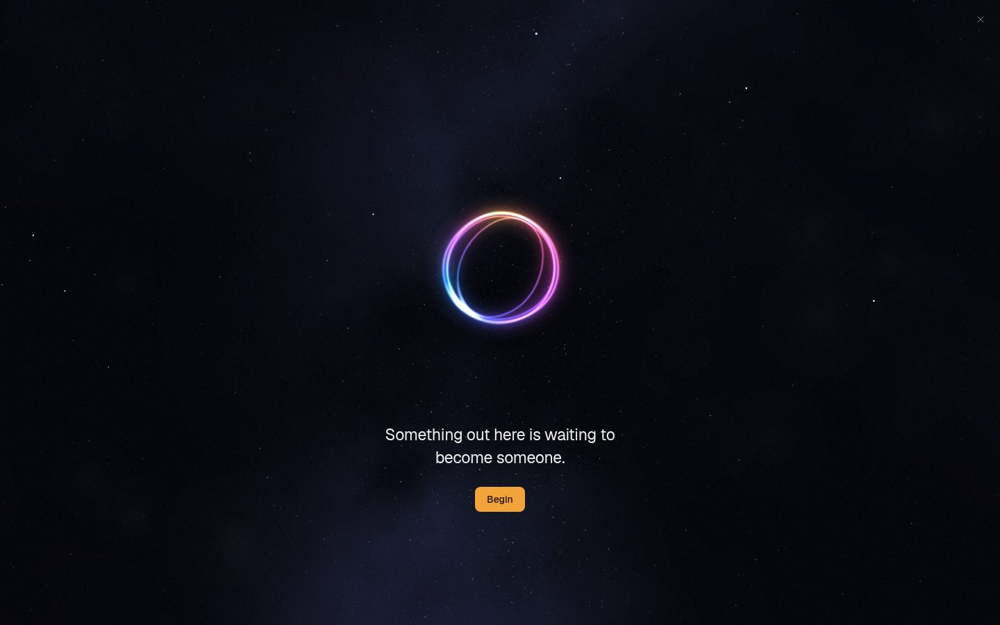
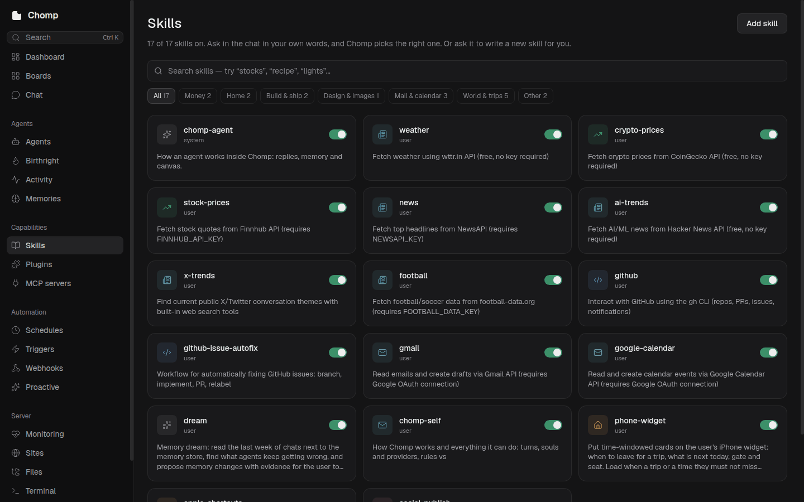

# Chomp

A personal AI assistant that runs on your own machine. You chat with it in a web app,
on Telegram or Discord, or by voice, and every message runs as an agent turn in the
Claude Code or Codex CLI with Chomp's tools: memory, Gmail, Calendar, Drive, rules
that run on a schedule or on events, dashboards, a live browser preview, published
sites and more.

It is built for **one person, on a private network**. The agents can run shell
commands on the host, and one password protects everything, so reach it over
Tailscale and do not put it on the public internet. [`SETUP.md`](SETUP.md) explains
why and how.


## What it does

- **Chat anywhere.** The web app, Telegram, Discord, or hands-free voice. Every
  message is a real agent turn on the Claude Code or Codex login you already have,
  so there are no API tokens to pay for chat.
- **Answers you can see.** Replies can hold cards, charts, tables, timelines, forms
  and drawings instead of a wall of text, and any of them can be pinned to a board.
- **Boards.** Dashboards of widgets that an agent builds for you and keeps fresh on a
  schedule (the picture above).
- **Memory.** It remembers facts and preferences from your chats, searches them by
  meaning (Ollama, OpenAI or Gemini embeddings), and an optional weekly "dream" proposes
  clean-ups for you to approve.
- **Proactive rules.** Prompts that run on a schedule, on an event (a webhook, a
  failed job, a service going down) or when a script says so, and only message you
  when something needs you.
- **Agents with a personality.** Birthright is a short interview that gives your
  assistant its character. Make more agents ("souls") for different jobs and pick
  one per chat with `@`.
- **Skills, plugins and MCP servers.** It reads Claude Code skills and plugins, so
  you teach it a new trick by writing a `SKILL.md`. Seeded skills cover weather,
  news, stocks, crypto, football, GitHub, Gmail and Calendar.
- **Your server, in a browser tab.** Monitoring of the machine and its containers
  and ports, a file browser, a terminal, a live preview of whatever an agent is
  building, and static sites it can publish for you.
- **Phone.** An optional SwiftUI app and home-screen widget, with push
  notifications and time-windowed cards ("leave for the airport in 20 minutes").

<table>
  <tr>
    <td></td>
    <td></td>
  </tr>
  <tr>
    <td></td>
    <td></td>
  </tr>
</table>

The screenshots are from a fresh install with sample data.

## Setup

**[`SETUP.md`](SETUP.md)** covers it from start to finish: required and recommended
tools, install, first login, running it as a service, Tailscale, and the add-ons.
It is written so that you can hand it to Claude Code or Codex and let it do the
setup with you.

The short version, for local development:

```bash
corepack enable
pnpm install --frozen-lockfile
cp .env.example .env          # then set JWT_SECRET to a long random value
pnpm dev                      # API on :3001, web on :5173
```

Open `http://localhost:5173`, choose a password, then open **Birthright** in the side menu: a
short interview that gives your assistant its personality.
You need Node 22 or newer and the Claude Code CLI, logged in.

## Stack

- **API:** Node, Express 5, WebSocket, Drizzle ORM on SQLite (`better-sqlite3`), JWT auth
- **Web:** React 19, Vite, Tailwind v4, Framer Motion
- **Agents:** Claude Agent SDK and Codex, which reach Chomp through its MCP server (`chomp-api`)
- **iOS:** a SwiftUI app and widget in `packages/ios` (optional)
- **Tooling:** pnpm 10 workspaces, TypeScript strict, Vitest, ESM throughout

## Repo layout

```
packages/
  api/            HTTP + WebSocket server, agent runtime, MCP tools, proactive rules, DB
  web/            React app: chat, settings, dashboards, rules, terminal, files
  shared/         Types shared by the packages
  ios/            iPhone app and widget
  cli/            Command-line client for Chomp's MCP tools over HTTP
  worker/         Old BullMQ worker (optional, needs Redis)
  outside-probe/  Cloudflare Worker that checks your services from outside (optional)
plugins/chomp/    Claude Code plugin to talk to Chomp from another machine
docs/             Configuration, deploy and design notes
```

## Working on the code

[`AGENTS.md`](AGENTS.md) (and `.claude/CLAUDE.md`) is the guide for coding agents:
commands, conventions, and how tests run. Frontend specifics are in
[`packages/web/CLAUDE.md`](packages/web/CLAUDE.md). Run `pnpm test` and `pnpm build`
before you commit; pull requests run the same checks in GitHub Actions
([`ci.yml`](.github/workflows/ci.yml)). Settings specific to one installation go in `.env` and are
described in [`docs/configuration.md`](docs/configuration.md), never in source files.

## License

[MIT](LICENSE).
